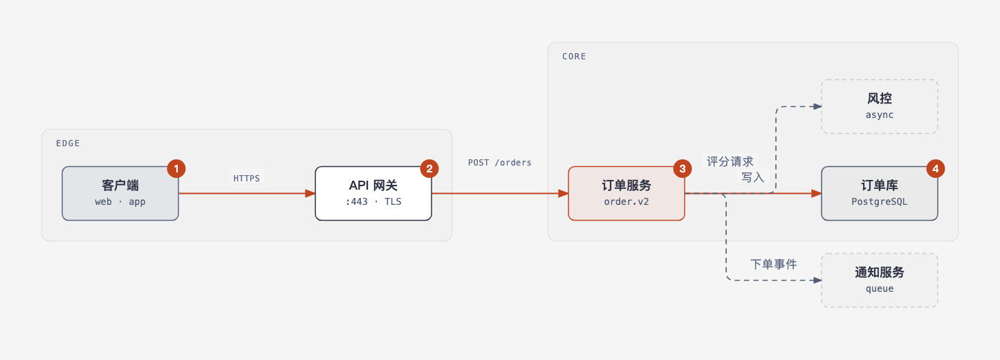
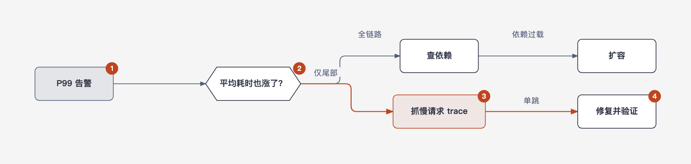
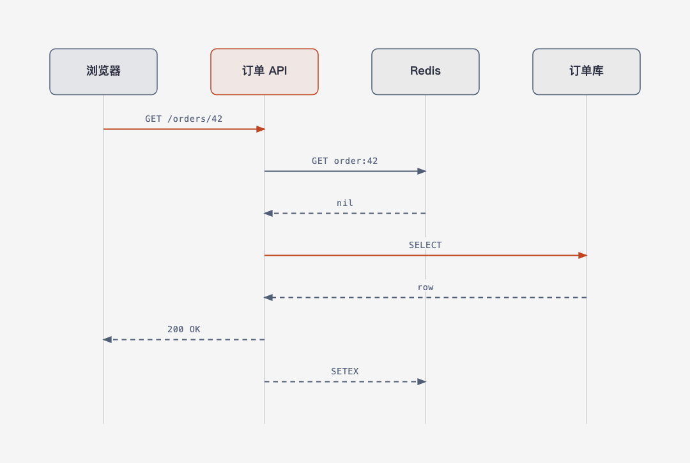
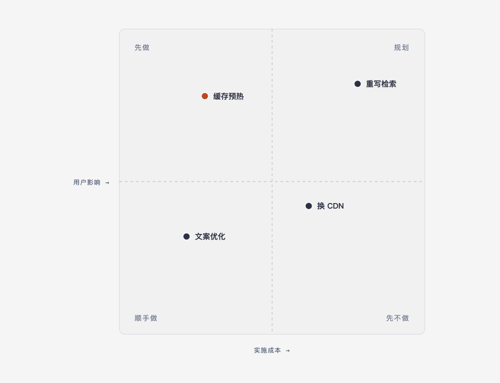

<p align="center">
  
</p>

<h1 align="center">readable-diagrams</h1>

<p align="center"><strong>Diagrams a reader understands on first look.</strong><br>
One JSON spec → one self-contained HTML page, with a machine-checked comprehension gate.</p>

<p align="center">
  <a href="https://github.com/bingomu/readable-diagrams/releases"></a>
  <a href="https://github.com/bingomu/readable-diagrams/actions/workflows/ci.yml"></a>
  <a href="LICENSE"></a>
  
  
</p>

English | [中文](README.zh.md)

---

## Why this exists

Two excellent skills already exist, and they solve different halves of the problem:

| Layer | Comes from | What it gives |
| --- | --- | --- |
| Validated spec pipeline | [Archify](https://github.com/tt-a1i/archify) (Apache-2.0) | JSON intermediate → deterministic render → gates |
| Editorial design system | [diagram-design](https://github.com/cathrynlavery/diagram-design) (MIT) | paper/ink/accent tokens, type ramp, orthogonal connectors, accessible SVG |
| **Comprehension contract** | this project | conclusion title, takeaway, numbered reading path, legend, caption — **and a checker that fails the page when they are missing** |

Neither parent validates that a human can *read* the result. That is the point of
this skill: the page is not allowed to ship unless the reading furniture is there,
the accent budget holds, contrast clears 4.5:1, and the connectors are orthogonal.

## What you get

- **Nine spec-driven types** — architecture, flow, state, sequence, timeline,
  tree, layer stack, bar, quadrant.
- **Chart families by hand** — line, scatter, sankey, radar, heatmap, Gantt, Venn,
  funnel, journey… drawn against the same furniture and the same gates.
- **Two gates, both must pass** — `self_check.py` (structure, accessibility,
  single-file safety) and `comprehension_check.py` (readability).
- **Hover interaction, no JavaScript** — hovering a node dims the rest and lights
  its edges; hovering a reading step lights its node; staggered entrance;
  reduced-motion and print fall back to the static frame.
- **Editorial skins** — light + dark, CJK-aware typography (12px floor, register
  switch for Chinese labels), 4px grid, no shadows.
- **Import / export** — Mermaid, draw.io and Excalidraw in; SVG and PNG out.
- **Eight example pages** in [`skills/readable-diagrams/examples/`](skills/readable-diagrams/examples/),
  each passing both gates.

## Quick start

```bash
git clone https://github.com/bingomu/readable-diagrams.git
cd readable-diagrams
SKILL=skills/readable-diagrams

python3 "$SKILL/scripts/render.py" "$SKILL/examples/architecture.spec.json" -o /tmp/page.html --json
python3 "$SKILL/scripts/self_check.py" /tmp/page.html
python3 "$SKILL/scripts/comprehension_check.py" /tmp/page.html
open /tmp/page.html
```

A minimal spec:

```json
{
  "type": "architecture",
  "meta": {
    "title": "一次下单请求如何穿过网关到达数据库",
    "takeaway": "写路径只有一条；风控与通知是旁路。",
    "caption": "从左往右是请求方向，实线同步、虚线异步。",
    "reading_path": ["client", "gateway", "orders", "pg"]
  },
  "nodes": [
    {"id": "client", "label": "客户端", "kind": "input"},
    {"id": "gateway", "label": "API 网关", "kind": "backend"},
    {"id": "orders", "label": "订单服务", "kind": "focal"},
    {"id": "pg", "label": "订单库", "kind": "store"}
  ],
  "edges": [
    {"from": "client", "to": "gateway", "label": "HTTPS", "variant": "accent"},
    {"from": "gateway", "to": "orders", "label": "POST /orders", "variant": "accent"},
    {"from": "orders", "to": "pg", "label": "写入", "variant": "accent"}
  ]
}
```

Full schema: [`skills/readable-diagrams/references/spec-schema.md`](skills/readable-diagrams/references/spec-schema.md).

## The two gates

```text
comprehension_check.py   title ≤60 · takeaway · caption · numbered reading path ·
                         legend coverage · ≤2 focal accents · node budget ·
                         edge-label coverage · type floors · contrast ·
                         orthogonal connectors · accessible SVG exists
self_check.py            role=img · title first · desc · prefixed ids ·
                         single-file safety · painted content inside viewBox
```

A non-zero exit is never success. Failures are ordinary evidence: fix the spec,
regenerate, rerun. Generated HTML is never hand-patched.

## Install

| Host | Install |
| --- | --- |
| **DeepSeek Harness** | Add this repo as a plugin: `dsh plugin --profile desktop add https://github.com/bingomu/readable-diagrams/archive/refs/tags/v1.1.0.tar.gz` — or the **Plugins → Add** page with the same URL. Restart the app; the skill appears in the session catalogue. |
| **Claude Code** | `/plugin marketplace add bingomu/readable-diagrams`, then install `readable-diagrams` — or copy `skills/readable-diagrams/` to `~/.claude/skills/`. |
| **Codex** | Copy `skills/readable-diagrams/` to `~/.codex/skills/`, or point Codex at the repo’s `.codex-plugin/` manifest. |
| **Any agent that reads `SKILL.md`** | `bash install.sh` (copies the skill folder to `~/.agents/skills/`). |

No npm package is required — every host installs from this repo. No build step and
no runtime dependencies either: Python 3.9+ for the scripts, Node 20+ only for the
DSH plugin wrapper.

## Examples

| | |
| --- | --- |
|  |  |
| architecture · zones, focal path | flow · a decision hexagon and two routes |
|  |  |
| sequence · who waits on which hop | quadrant · one recommendation, three also-rans |

Open any `skills/readable-diagrams/examples/*.html` in a browser to try the hover
layer.

## Repo layout

```text
.
├── package.json                 DSH plugin package (dsh.bundle)
├── cordis.patch.yml             mounts the skill plugin row
├── lib/index.js                 registers the skill with DSH
├── locale/{en,zh}.json          plugin page copy
├── icon.svg
├── skills/readable-diagrams/    ← the installable skill
│   ├── SKILL.md                 operating instructions for an agent
│   ├── references/              comprehension, design system, spec schema, router, import/export
│   ├── scripts/                 render · both gates · export · import extractors
│   ├── assets/template.html     manual-authoring scaffold
│   └── examples/                eight demos + their specs
├── scripts/check.py             repo gate suite (what CI runs)
├── .claude-plugin/              Claude Code plugin + marketplace manifests
├── .codex-plugin/               Codex plugin manifest
├── .agents/plugins/             generic agent marketplace manifest
└── docs/DETAIL.md               plugin-page detail copy
```

## Contributing

Run `python3 scripts/check.py` before pushing; it renders every example, runs
both gates, and parses the plugin entry point. See
[CONTRIBUTING.md](CONTRIBUTING.md) and [AGENTS.md](AGENTS.md).

## License and provenance

MIT. `self_check.py` and the Mermaid / draw.io / Excalidraw extractors are
vendored MIT code from diagram-design; the design tokens and connector grammar
are adapted from it with attribution. Archify contributed concepts and the
delivery discipline, not code. Details in
[THIRD_PARTY_NOTICES.md](THIRD_PARTY_NOTICES.md).

Built for the [DeepSeek Harness](https://github.com/deepseek-ai/deepseek-harness)
plugin ecosystem; the skill folder itself is host-agnostic.
