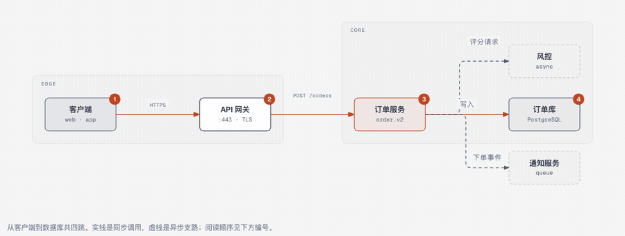
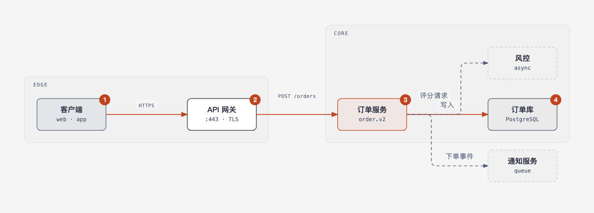
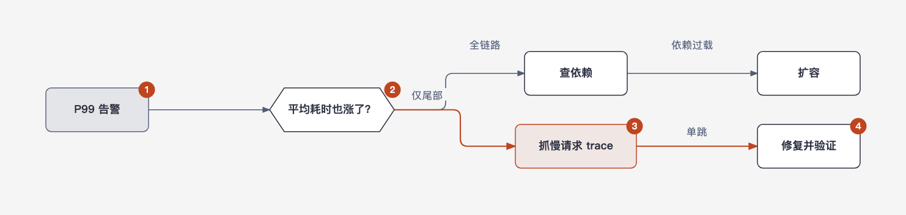

<p align="center">
  
</p>

<h1 align="center">readable-diagrams · 可读图表</h1>

<p align="center"><strong>让读者一眼看懂的图表。</strong><br>
一份 JSON 规格 → 一个自包含 HTML 页面，附一道机器可查的「阅读闸门」。</p>

<p align="center">
  <a href="https://github.com/bingomu/readable-diagrams/releases"></a>
  <a href="https://github.com/bingomu/readable-diagrams/actions/workflows/ci.yml"></a>
  <a href="LICENSE"></a>
  
</p>

[English](README.md) | 中文

---

## 为什么有它

上游两个优秀技能各解决一半问题：

| 层 | 来自 | 提供 |
| --- | --- | --- |
| 规格流水线 | [Archify](https://github.com/tt-a1i/archify)（Apache-2.0） | JSON 中间层 → 确定性渲染 → 闸门 |
| 编辑设计系统 | [diagram-design](https://github.com/cathrynlavery/diagram-design)（MIT） | 纸/墨/橙 token、字号阶梯、正交连线、可访问 SVG |
| **阅读契约** | 本项目 | 标题即结论、一句话 takeaway、编号阅读动线、图例、图注——**缺一项就不让交付** |

两个上游都不校验「人能不能读懂」。这个技能的差别就在这里：页面必须带齐阅读家具，
焦点不超过 2 个，对比度 ≥4.5:1，连线必须正交，否则闸门不通过。

## 你会得到

- **9 种规格引擎类型**：architecture / flow / state / sequence / timeline /
  tree / layers / bar / quadrant。
- **图表族手绘路线**：折线、散点、桑基、雷达、热力、甘特、Venn、漏斗、旅程……
  共用同一套页面家具与同一套闸门。
- **两道闸门都必须过**：`self_check.py`（结构/可访问性/单文件安全）+
  `comprehension_check.py`（可读性）。
- **纯 CSS 悬停交互**：悬停节点其余变淡、邻边点亮；悬停阅读步骤联动高亮节点；
  入场错峰动画；`prefers-reduced-motion` 与打印自动降级。
- **双主题 + 中文排版**：浅/深两套，CJK 12px 下限、中文标签自动切换字号与字距。
- **导入导出**：Mermaid / draw.io / Excalidraw 进，SVG / PNG 出。
- **8 个示例页面**：`skills/readable-diagrams/examples/`，全部双闸门通过。

## 快速开始

```bash
git clone https://github.com/bingomu/readable-diagrams.git
cd readable-diagrams
SKILL=skills/readable-diagrams

python3 "$SKILL/scripts/render.py" "$SKILL/examples/architecture.spec.json" -o /tmp/page.html --json
python3 "$SKILL/scripts/self_check.py" /tmp/page.html
python3 "$SKILL/scripts/comprehension_check.py" /tmp/page.html
open /tmp/page.html
```

最小规格见 [README.md](README.md#quick-start) 或
[spec-schema.md](skills/readable-diagrams/references/spec-schema.md)。

## 安装

| 宿主 | 方式 |
| --- | --- |
| **DeepSeek Harness** | 把仓库当插件安装：`dsh plugin --profile desktop add https://github.com/bingomu/readable-diagrams/archive/refs/tags/v1.1.0.tar.gz`，或在「插件 → 添加」页填同一地址；重启后技能出现在会话技能目录。 |
| **Claude Code** | `/plugin marketplace add bingomu/readable-diagrams` 后安装；或把 `skills/readable-diagrams/` 复制到 `~/.claude/skills/`。 |
| **Codex** | 把 `skills/readable-diagrams/` 复制到 `~/.codex/skills/`，或指向仓库的 `.codex-plugin/`。 |
| **任何读 SKILL.md 的 agent** | `bash install.sh`（复制到 `~/.agents/skills/`）。 |

无构建步骤、无运行时依赖；脚本需要 Python 3.9+，DSH 插件包装层需要 Node 20+。

## 示例




打开 `skills/readable-diagrams/examples/*.html` 可试悬停效果。

## 目录

```text
package.json / cordis.patch.yml / lib/index.js   DSH 插件入口（dsh.bundle）
locale/ icon.svg                                  插件页文案与图标
skills/readable-diagrams/                         ← 可安装的技能本体
  SKILL.md · references/ · scripts/ · assets/ · examples/
scripts/check.py                                  CI 跑的闸门套件
.claude-plugin/ .codex-plugin/ .agents/plugins/   跨 agent 清单
docs/DETAIL.md                                    插件页详情文案
```

## 贡献

推送前跑 `python3 scripts/check.py`。规则见 [CONTRIBUTING.md](CONTRIBUTING.md) 与
[AGENTS.md](AGENTS.md)。

## 许可与来源

MIT。`self_check.py` 与三个导入提取器是 diagram-design 的 MIT 代码（已致谢）；
设计 token 与连线规则改编自它。Archify 提供的是概念与交付纪律，未复制代码。
详见 [THIRD_PARTY_NOTICES.md](THIRD_PARTY_NOTICES.md)。

为 [DeepSeek Harness](https://github.com/deepseek-ai/deepseek-harness) 插件生态而做，
技能本体与宿主无关。
